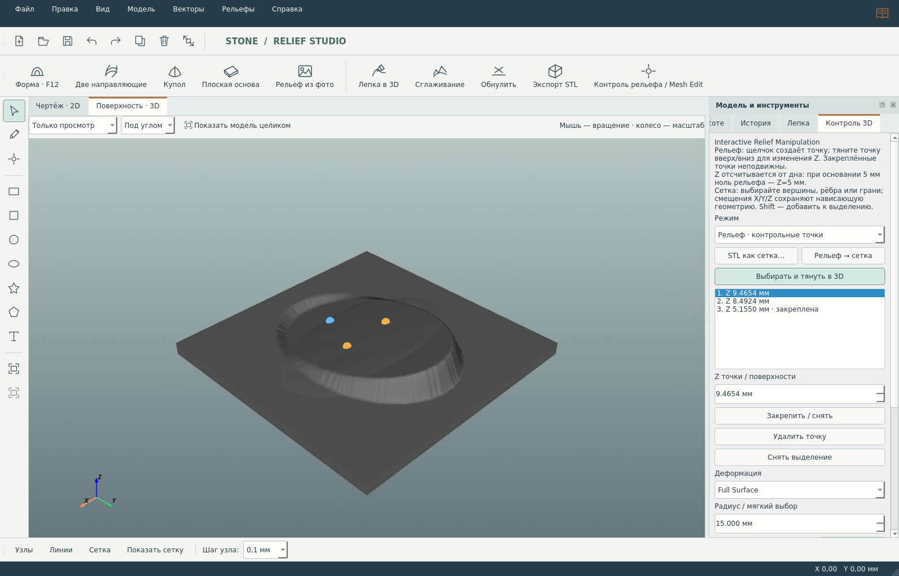

# Stone Relief Studio Pro 3.3.1 — исправление размеров, выбора и высоты F12

Полная программа поставляется одним файлом **stone_relief_studio_fixed.py**, без ZIP и без вспомогательных модулей исходного кода. Продолжается исходная программа пользователя: векторы, F12, две направляющие, деформации, прежняя «Лепка в 3D», импорт/экспорт STL/SVG, импорт DXF и фото, Undo/Redo и справочник сохранены.

Это рабочий проверяемый этап большого ТЗ: аудит надёжности + контрольные точки + отдельный Mesh Edit. Полная система слоёв и остальные крупные функции ещё не выданы за готовые. Список: [AUDIT_STAGE1.md](AUDIT_STAGE1.md).

## Исправления 3.3.1

- Сверху есть отдельная кнопка **РАЗМЕРЫ МОДЕЛИ**. Новый проект тоже начинается с этого диалога. Все поля в мм: X, Y, основание, высота рельефа, шаг сетки.
- Изменение X/Y масштабирует всю композицию и пересчитывает сетку; изменение основания сдвигает верхнюю поверхность по Z. Высота рельефа задаёт предупреждение для F12 и амплитуду построения из фото; уже созданную поверхность это поле не растягивает. Укрупнение шага может уменьшить детали: перед изменением содержимого требуется подтверждение. Один Undo возвращает геометрию и размеры. Для произвольной сетки X/Y масштабируются без проекции; толщина основания изменяется в Mesh Edit.
- В двух направляющих нажмите «Выбор», затем **один раз щёлкните открытый вектор**. Окно вернётся автоматически. Первая направляющая синяя, вторая оранжевая, сечения фиолетовые. Прямая и кривая Безье поддерживаются; Esc отменяет выбор, прежние назначения остаются.
- В F12 по умолчанию выбрана **Точная высота в мм**. При основании 5 мм и начальной высоте 0 добавление 2 мм на плоскую плиту даёт Z=7 мм; 7 мм даёт Z=12 мм. Угол округлой формы меняет профиль, сохраняя максимум. Отрицательный угол создаёт выемку с прежней защитой Z≥0,05 мм. Начальная высота задаёт отдельное смещение относительно верха основания.
- Геометрический множитель ×0,1…5 теперь действует только в режиме «По углу и ширине». Числовые режимы exact/limit/scale/const не умножают заданные миллиметры повторно. Режим без ограничения сохранён, но обозначен явно; старые сохранённые настройки не подменяются молча точным режимом.
- «Добавить» выбирает операцию (зелёная кнопка), **«Применить» выполняет её**. Добавлен режим «Заменить». Отчёт показывает диапазон создаваемой формы, реальные Z до/после и максимальное изменение в мм. При сложении выше указанной высоты рельефа нужна явная кнопка «Да»; отказ сохраняет исходную поверхность.
- Повторное Add накапливает высоту: 2 мм, затем 7 мм на основании 5 мм дают **Z=14 мм**. Replace 7 мм возвращает максимум к **Z=12 мм**. 3D использует одинаковый масштаб X/Y/Z = 1:1; отдельного скрытого усиления Z нет. Высота F12 не меняет размеры X/Y.

Формат проекта остаётся 5; открываются проекты 2–5. Новые параметры F12 `exact`/`replace` требуют 3.3.1: предшествующая 3.3 не поддерживает эти настройки. Все прежние инструменты сохранены. Подробности и результаты проверок: [CHANGES_3_3_1.md](CHANGES_3_3_1.md), [TEST_RESULTS.md](TEST_RESULTS.md).

## Windows 10/11 x64: установка

Установите 64-битный Python 3.12 с Python Launcher. В командной строке в папке программы:

```bat
py -3.12 -m venv .venv
.venv\Scripts\python.exe -m pip install -r requirements.txt
.venv\Scripts\python.exe stone_relief_studio_fixed.py
```

Если скачан только `.py`, установите библиотеки командой из начала файла либо скачайте рядом requirements.txt. Другие Python-модули программы не требуются. Также предоставлены INSTALL_WINDOWS.bat и START_WINDOWS.bat. Нужен рабочий графический сеанс и драйвер с OpenGL для VTK.

Доступность бинарных зависимостей CPython 3.12 / win_amd64 проверена через pip --dry-run; список в [WINDOWS_WHEELS.md](WINDOWS_WHEELS.md). **Запуск на Windows 10 и 11 не проверен**. Windows 7 не поддерживается текущим PySide6/Qt6; для неё нужен отдельный порт, который ещё не выполнен.

## Interactive Relief Manipulation

1. Создайте рельеф или плоскую основу. Для лепестка выделите его замкнутый контур в 2D.
2. Нажмите сверху **Контроль рельефа / Mesh Edit**, выберите «Рельеф» и включите **Выбирать и тянуть в 3D**.
3. Щелчок на поверхности создаёт точку. Щёлкните точку и тяните по вертикали или измените численное поле Z. **Z отсчитывается от дна**: при основании 5 мм нулевой рельеф имеет Z=5 мм.
4. Local меняет поверхность в радиусе; Full Surface интерполирует ограничения по всей области. Сила 1 соответствует заданной высоте; радиус и плавность — в мм. Если несколько точек противоречат друг другу или совпадают, расчёт сообщит об этом.
5. «Закрепить / снять» фиксирует выбранную точку. Синие точки закреплены, золотые свободны. Фиксация края сохраняет внешний ряд ячеек области неподвижным. Выбранные контуры области запоминаются в проекте; снимите ограничение, чтобы работать со всей плитой.
6. Предпросмотр рассчитывается в рабочем потоке, исходные высоты не меняются. После проверки нажмите **Применить**. Один Ctrl+Z отменяет применённую деформацию, Ctrl+Y возвращает её.
7. Для вращения камеры выключите выбор/перетаскивание. Прежняя «Лепка в 3D» доступна отдельно; одновременное включение двух режимов исключено.

Деформируется гладкое поле смещения, которое добавляется к исходным высотам. Мелкая фактура не проходит через сглаживающий фильтр. На больших моделях расчёт не мгновенный; прогресс и отмена доступны.

## Mesh Edit без потери нависающих деталей

1. В том же инструменте нажмите **STL как сетка**. Этот путь не преобразует модель в карту высот и сохраняет координаты/грани, включая поднутрения.
2. Выберите Mesh Edit и режим выделения: вершины, рёбра либо грани. ЛКМ выбирает, Shift+ЛКМ добавляет к выбору.
3. Задайте смещения X/Y/Z в мм или ось перетаскивания. Радиус задаёт мягкое влияние; закреплённые вершины остаются на месте.
4. Выполните предпросмотр и примените. Undo возвращает исходную сетку вместе с её отображением; проект сохраняет вершины, индексы, закрепления и параметры.
5. **Рельеф → сетка** строит сетку полного разрешения. Undo возвращает исходную карту высот. Это отдельный режим, а не попытка хранить сетку в одной высоте на XY.

Перемещение вершин может создавать самопересечения. Полный STL Inspector пока не готов: экспорт проверяет рёбра, нормали, вырождение и точность, но не все пересечения и не толщину произвольной сетки.

## STL, размеры и проекты

В панели «Модель» настраиваются минимальное основание при экспорте карты высот (по умолчанию 0,5 мм) и допустимая ошибка float32 (0,001 мм). Превышение блокирует запись и объясняет причину. STL передаёт числовые координаты; при открытии выбирайте миллиметры.

Новый формат `.srelief` — **5**. Открываются форматы **2, 3, 4**. Чтение старого проекта не переписывает исходный файл. Явное сохранение записывает новый формат атомарно; старые версии программы формат 5 не откроют. Сохранены фото, векторы и UID, рельеф либо исходная сетка, параметры F12/направляющих, контрольные точки, закрепления и ссылки на маску области. При отмене или ошибке записи прежний файл остаётся целым.

Лимиты входных данных и оставшиеся ограничения перечислены в AUDIT_STAGE1.md. Они нужны для предсказуемого расхода памяти; карта рельефа по-прежнему ограничена сеткой ядра.

## Привычные действия

- Home показывает текущую модель целиком в 2D/3D; Ctrl+Home приближает выделенные векторы.
- F12 открывает прежний редактор формы, Ctrl+S сохраняет, Ctrl+Z/Ctrl+Y управляют историей.
- Размеры выделенных векторов — вверху панели модели. Недавние проекты — в меню «Файл».
- Радиус обычной кисти, шаг узлов, привязки и расположение панелей запоминаются.
- Книга вверху справа / F1 открывает справочник на русском, включая новые инструменты и схемы.

## Автоматические испытания

```bat
.venv\Scripts\python.exe -m pip install pytest==9.1.1
.venv\Scripts\python.exe -m pytest -q -W error::RuntimeWarning checks
```

Папка checks тестирует именно единый распространяемый файл. GUI-проверкам нужен графический сеанс с OpenGL. На Linux используются те же команды через python3/venv, с активным X11/Wayland. Результаты — в [TEST_RESULTS.md](TEST_RESULTS.md). В этой среде нет Windows: проверки wheel не заменяют реальные испытания GUI и EXE.

## Автономный EXE

Собирать Windows-версию нужно на Windows 10/11 x64 в подготовленном окружении:

```bat
.venv\Scripts\python.exe -m pip install pyinstaller
.venv\Scripts\python.exe -m PyInstaller --noconfirm --clean --onedir --windowed --name StoneReliefStudioPro --collect-all vtkmodules --collect-all pyvista --collect-all pyvistaqt --collect-all scipy --collect-all shapely --hidden-import PySide6.QtSvg --hidden-import PySide6.QtOpenGLWidgets stone_relief_studio_fixed.py
```

Результат: `dist\StoneReliefStudioPro\StoneReliefStudioPro.exe`. Копируйте **всю папку**, включая DLL; Python на целевом ПК не требуется. Для единственного EXE замените --onedir на --onefile: файл будет крупным и станет распаковываться при каждом запуске. После сборки проверьте запуск, 3D, SVG/DXF, сохранение, импорт/экспорт STL и тесты на Windows 10 и 11. **Сборка EXE здесь не выполнялась и не испытана.**


## Исходный код для разработки

Единый файл содержит всю программу. В папке `source/` дополнительно сохранены те же модули для аудита и дальнейшей разработки. Их не нужно скачивать для запуска одного `.py`.

```bat
py -3.12 source\build_single_file.py stone_relief_studio_fixed.py
```

Сборщик воспроизводит единый файл из этих модулей. `checks/` проверяет результат, а не незавершённые части. CODE_INVENTORY.md перечисляет классы/функции и связи; AUDIT_STAGE1.md — подтверждённые исправления и оставшиеся этапы. Для EXE также предоставлен BUILD_WINDOWS_EXE.bat (в Windows здесь не запускался).


## Готовый пример

Откройте [examples/interactive_petal.srelief](examples/interactive_petal.srelief), затем «Контроль рельефа / Mesh Edit» и включите выбор точек. В примере три ограничения: основание закреплено, две точки подняты, край сохранён. Можно менять высоты и пересчитывать форму.


